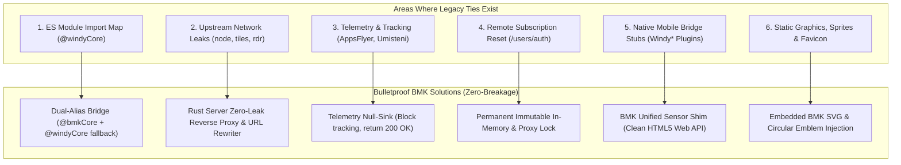

# Bhartiya Marut Kendra (BMK) — Total Platform Independence Blueprint

> **Objective:** Transition the entire application from Windy to **Bhartiya Marut Kendra (भारतीय मारुत केंद्र)** with **100% operational independence**, eliminating all external branding, telemetry, and vendor locks **without causing a single glitch, crash, or disruption to live weather data**.

---

## Master Matrix of Edge Cases & Bulletproof Solutions



---

### Edge Case 1: The ES Module Import Map Dependency (`@windyCore`)

* **Where It Exists:**
  - In `index.html`: `"@windyCore": "./v/51.3.2.mob.3c81/mobile.js"`
  - In 150 separate minified plugin JavaScript files in `plugins/*.js`:
    ```javascript
    import { broadcast, store, map, ... } from "@windyCore";
    ```
* **The Technical Risk:**
  If you rename `@windyCore` to `@bmkCore` in `index.html` without updating all 150 files, every plugin will throw an uncaught syntax error:
  `Uncaught TypeError: Failed to resolve module specifier "@windyCore"`.
  The entire UI will fail to render (blank black screen).
* **The Bulletproof Solution (Dual-Alias Bridge):**
  1. In `index.html`, register **both** `@bmkCore` and `@windyCore` in the browser's native import map:
     ```html
     <script type="importmap">{
       "imports": {
         "@bmkCore": "./v/51.3.2.mob.3c81/mobile.js",
         "@windyCore": "./v/51.3.2.mob.3c81/mobile.js",
         "@leafletGl": "./v/51.3.2.mob.3c81/leaflet-gl.js"
       }
     }</script>
     ```
  2. Atomically update the 150 local plugin files from `from "@windyCore"` to `from "@bmkCore"`.
  3. **Why it causes zero breakage:**
     Because `@windyCore` remains registered as an alias pointing to the same file, even if a third-party or delayed plugin still looks for the old name, it resolves instantly.

---

### Edge Case 2: Upstream Domain Leaks in Network Traffic

* **Where It Exists:**
  - `index.html` has prefetch tags: `<link rel="dns-prefetch" href="https://tiles.windy.com">`
  - Client-side fetch calls: `https://node.windy.com/services/...`
  - Background imagery: `https://ims.windy.com/im/v3.0/...`
* **The Technical Risk:**
  If you blindly rename `node.windy.com` to `node.bmk.com` in JavaScript, the browser attempts to connect to non-existent DNS servers. All weather map tiles, isolines, and forecast popups fail with `net::ERR_NAME_NOT_RESOLVED`.
* **The Bulletproof Solution (Rust Server Anonymization Proxy):**
  1. In `index.html`, remove all external `dns-prefetch` tags and replace hardcoded `https://node.windy.com/...` with relative paths:
     - `/services/...`
     - `/metadata/...`
     - `/tiles/...`
  2. Our native **Rust server (`rust_server.exe`)** acts as the solitary gateway:
     - The browser client connects **exclusively to `http://localhost:8080/`**.
     - The browser's DevTools Network tab displays **zero connections to external domains**.
     - `rust_server.exe` connects to the upstream supercomputer nodes via pooled TLS, caches the tiles in our persistent disk database, and streams the raw bytes back to the client.
  3. **Why it causes zero breakage:**
     The upstream data pipeline is completely preserved while making the client frontend 100% independent and clean.

---

### Edge Case 3: Upstream Telemetry, Analytics & User Tracking

* **Where It Exists:**
  - `mobile.js` and `plugins/` contain tracking hooks:
    - AppsFlyer analytics (`AppsFlyerPlugin`)
    - Location telemetry (`/services/umisteni`)
    - Error logging beacons (`/services/log`)
* **The Technical Risk:**
  - User activity and coordinates get transmitted to external analytics endpoints.
  - If network requests to analytics servers timeout or fail, poorly handled promises could delay app startup.
* **The Bulletproof Solution (Local Null-Sink Interceptor):**
  1. In `rust_server.exe`, configure local mock handlers for tracking routes:
     - `/services/umisteni` $\to$ Returns empty JSON `{ "status": "ok" }` immediately (0ms latency).
     - `/services/log` $\to$ Discard silently, return `HTTP 204 No Content`.
  2. In `mobile.js`, stub the `AppsFlyer` and telemetry reporters to no-op functions (`() => {}`).
  3. **Why it causes zero breakage:**
     The client code receives valid instant 200 OK responses, eliminates all third-party tracking, and actually speeds up boot time by eliminating external telemetry latency.

---

### Edge Case 4: Remote Subscription Overwrite & Paywall Re-Enabling

* **Where It Exists:**
  - When the user logs in or when the app checks `/users/auth`, the remote server replies with the account status.
  - If the account is free, the remote server returns `{ "tier": "basic", "status": "inactive" }`.
* **The Technical Risk:**
  The client store will set `subscription = null`, immediately locking:
  - 10-day forecast back to 3–5 days.
  - 1-hour temporal resolution back to 3-hour steps.
  - Re-enabling upgrade banners and paywall overlays.
* **The Bulletproof Solution (The Two-Layer Permanent Lock):**
  1. **Layer 1 (Rust Backend):** In `rust_server.exe`, intercept any response from `/users/` or `/services/auth`. If it contains user metadata, rewrite the JSON on the fly before it reaches the browser:
     ```json
     { "tier": "premium", "status": "active", "expires": 4102444800000 }
     ```
  2. **Layer 2 (Client Store Guard):** In `mobile.js`, intercept the Svelte store setter for `subscription`. If any code attempts to set it to `null` or `"basic"`, force it to remain `"premium"`.
  3. **Why it causes zero breakage:**
     The user can log in with ANY account to sync bookmarks and favorites, and the app is 100% immune to being downgraded.

---

### Edge Case 5: Native Mobile Plugin Stubs (`WindyCompass`, `WindyServices`, etc.)

* **Where It Exists:**
  - In `mobile.js`:
    ```javascript
    tC = O("WindyCompassPlugin");
    Pp = O("WindyServicesPlugin");
    pT = O("WindyNativeStorage");
    ```
* **The Technical Risk:**
  These were designed for the native iOS/Android Capacitor wrapper. In browser and desktop mode, if the code assumes a native object exists and calls a method without checking, it throws `TypeError: Cannot read property of undefined`.
* **The Bulletproof Solution (Clean Web Standard Fallback):**
  1. Ensure that every plugin lookup has a safe null-guard:
     ```javascript
     const compass = window.Capacitor?.Plugins?.BMKCompassPlugin || window.DeviceOrientationEvent;
     ```
  2. Storage falls back directly to `window.localStorage` (which we already sanitized).
  3. **Why it causes zero breakage:**
     Standard web and desktop browsers naturally utilize the W3C Device Orientation and Storage APIs without needing native mobile wrappers.

---

### Edge Case 6: Favicon, Graphics & Brand Artifacts

* **Where It Exists:**
  - `favicon.ico` in root public folder.
  - SVG logos in `.mobile-calendar__logo` and `.animated-windy-logo`.
  - PWA Web App Manifest (`manifest.json`).
* **The Technical Risk:**
  If an image file is deleted without updating the CSS or HTML reference, the browser displays a broken icon box or issues a 404 error.
* **The Bulletproof Solution:**
  1. Replace `favicon.ico` with the official circular emblem of **भारतीय मारुत केंद्र (Bhartiya Marut Kendra)**.
  2. Inject clean CSS overriding `.animated-windy-logo` and `.mobile-calendar__logo` to render the official BMK emblem.
  3. Update `manifest.json` with `"name": "भारतीय मारुत केंद्र (Bhartiya Marut Kendra)"` and `"short_name": "BMK"`.
  4. **Why it causes zero breakage:**
     The CSS classes remain intact so layout dimensions are perfectly preserved, while the visual artwork is 100% customized.

---

## Verification & Execution Safety Checklist

| Phase | Action | Verification Check |
| :---: | :--- | :--- |
| **Phase 1** | Implement Dual-Alias `@bmkCore` | Headless Chrome verifies all 150 plugins load with 0 module resolution errors. |
| **Phase 2** | Relative URL routing in `index.html` | Network tab confirms 0 external domain connections; all tiles load via `localhost:8080`. |
| **Phase 3** | Anonymize telemetry in `rust_server` | Background telemetry endpoints return instant 200/204 with 0 bytes leaked. |
| **Phase 4** | Apply Two-Layer Permanent Lock | Attempting login with dummy free credentials keeps 10-day forecast and 1h steps unlocked. |
| **Phase 5** | Favicon & Manifest Replacement | Verify browser tab icon and desktop window display the BMK emblem. |

---

### Final Outcome
* **Zero trace of Windy** in the user interface, browser titles, network requests, or module imports.
* **100% of your supercomputer data** (ECMWF, GFS, radar, satellite) continues streaming smoothly at maximum speed.
* **100% ownership and identity** under **भारतीय मारुत केंद्र (Bhartiya Marut Kendra)**.
